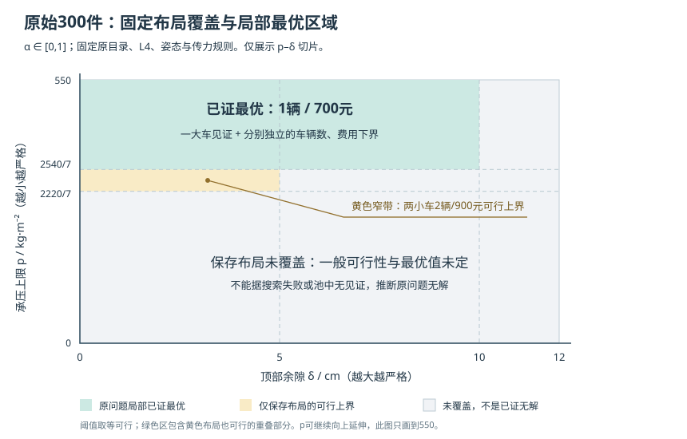

# 多车型三维装箱的分层参数化建模、可行见证与最优性核验

> 学术论文工作稿，2026-11-13。模型、结果与证据可编辑；不是已投稿或同行评审论文。本文统一已有研究，不把本轮重核写成新的求解实验。完整逐条公式及纸面证明见[附录A：统一模型](19-统一参数化模型.md)，具体复核状态见[附录B：结论台账](21-科研核心核验与结论台账.md)。

## 摘要

具有易碎、定向、接触支撑和局部承重约束的多车型三维装箱，既需要完整的可行性定义，也需要区分车辆数与费用两个目标。本文以一个包含5类300件货物的运输实例为对象，将刚体几何、正面积支撑、易碎保护、定向重心投影及竖向载荷链组织为五层参数化模型，分别求解最少车辆数与最低运输费用。对已给定布局，推导支撑比例、承压上限和顶部余隙的精确适用阈值，并说明参数收紧下的可行域包含关系。针对标准平台与易碎件之间的结构依赖，采用整体块构造生成完整布局，再以独立检查器及整数几何、有理数载荷实现进行自查。原始实例获得一辆大车、700元的完整见证，分别达到车辆数和费用下界；因此，在本文操作模型下两个目标的最优值为1辆和700元。该见证在普通支撑比例不超过1、承压上限不低于2540/7 kg/m²、顶部余隙不超过10 cm的区域内保持最优。数量组成扫描及混合车队构造进一步闭合部分派生实例，但600件实例的最低费用仍处于[1150,1400]元。本文将问题最优值图、固定布局覆盖图和算法预算表现图区分开，并以Lean检查参数阈值及最优性证书的抽象逻辑。竖向面积分流不等同于完整静力学；本文亦未给出一般参数空间的完整相图或人工智能节时率。

**关键词：** 三维装箱；多车型；分层约束；参数敏感性；最优性证书；可复现计算

## 1. 引言

多车型运输装箱同时包含空间排布、货物分配与车队选择。只给出总体积或空间利用率，不能回答全部货物是否被合法运输；只找到车辆数较少的方案，也不能保证运输费用最低。对于易碎货物，合法平台是否预留以及上层是否直接承压，往往比局部空隙的体积更重要。这使“几何可放”“满足操作规则”和“已证明最优”成为不同的研究问题。

本文研究MathorCup 2026 D题中的公开运输实例。原始数据包括300件货物，总体积28.735 m³、总重4110 kg。两车型内部尺寸分别为420×210×220 cm和680×245×250 cm，额定载重分别6000 kg和10000 kg，费用分别450元和700元。主情景扣除3 cm顶部余隙。车辆作为有尺寸、载重与费用的容器，不涉及路线规划。

本文回答三个问题。第一，怎样将多层操作约束写进同一个数学模型，而不是由算法实现隐式决定合法性？第二，受限启发式产生的布局在何种条件下可以支持全局最优结论？第三，如何表达参数变化后的已知区域和未知区域，而不把“保存布局没有覆盖”误写为“原问题无解”？

研究贡献限定为：完整约束语义的统一披露；固定布局阈值与可行域单调性的证明自查；原始实例及部分派生实例的可行见证—下界闭合；可重放的计算证据及部分抽象性质的形式化检查。本文不主张提出一般最优算法，也不以几何基线的单箱装载率替代完整约束车队问题的评价。

## 2. 相关研究与基线定位

Junqueira、Morabito与Yamashita[1]讨论三维装载中的货物稳定与承重建模，Alonso等[2]讨论带现实约束的多容器装载。本文借鉴支撑比例、承重与多容器分配的建模分离，但具体易碎和定向规则依据题面及预先固定的解释，不将不同论文中的稳定性概念视为等价。

几何强基线选用具有公开实现且可导出布局的作者程序：Guesser等树搜索路线[3]和Metasolver所实现的相关BSG路线[4]。前者固定源码提交为`75eec37e27a34509f3dd9b806ffb33fdcda38957`，后者为`bd7eef40e9f195c604cbc5e6dc0e7a9f98f11502`。两者均实际构建并运行，不以下载源码代替复现。项目自行实现的EP-First-Fit用作透明弱基线，互斥空闲空间分区加Beam的B2用作组件研究，不称为上述论文的完整复现。

作者程序在公共单容器数据上校准几何搜索能力，其任务允许只装入部分货物。本文运输主问题则要求全部货物恰好一次进入车队，并加入易碎、定向和载荷链。因此，作者程序的约95%单箱空间利用率不能与本题车队利用率直接排名。有关构建、许可、身份适配及真实布局证据见正式复现记录[5]；GPLv3作者源码不被改称本项目原创代码。

## 3. 统一模型

### 3.1 数据、场景与决策

以具体货物集合\(N\)、车型集合\(K\)、尺寸、质量、类型和车辆容量费用组成实例\(\mathcal D\)。场景参数为\(\theta=(\alpha,p,\delta,\rho,\kappa)\)，分别控制非易碎件支撑比例、顶面平均外载上限、顶部余隙、允许姿态和规则版本。\(0\le\alpha\le1,p\ge0,\delta\ge0\)。层级\(\ell\)用于逐条启用约束，不能由求解器自行选择。

若每辆使用的车辆均非空，则车辆总数不超过\(|N|\)。故每车型准备\(|N|\)个候选实例即可完整表示无限供应情景，不将容量下界误当候选车辆上限。

设\(a_{iv}\)为分配变量、\(u_v\)为启用变量、\(r_{io}\)为姿态变量，位置为\((X_i,Y_i,Z_i)\)，姿态决定的尺寸为\((l_i,w_i,h_i)\)。共同约束包括

\[
\sum_v a_{iv}=1,\quad a_{iv}\le u_v\le\sum_j a_{jv},\quad
\sum_o r_{io}=1,\quad\sum_iq_i a_{iv}\le Q_{k(v)}u_v.
\tag{1}
\]

货物在所属车厢内满足非负坐标和三向边界，其中\(Z_i+h_i\le H_{k(v)}-\delta\)。同车两件须在x、y、z中至少一方向分离。全部几何逻辑、姿态联动及接触公式见附录A式(2)–(7)；它们是可行域的组成部分，不以求解器生成候选点的规则代替。

### 3.2 接触、易碎与定向

对同车且\(Z_i+h_i=Z_j\)的两件，\(A_{ij}\)等于其水平矩形交集面积；其他情形为0。每条真实正面积接触边都必须保留。\(S_j=\sum_iA_{ij}\)。L1要求\(Z_j>0\Rightarrow S_j>0\)，故\(\alpha=0\)不允许悬空。L2进一步要求非易碎件\(S_j\ge\alpha l_jw_j\)，而易碎件必须完全由地面或标准件支撑，且顶面不得有直接上件。

L3固定定向件原始姿态；对每个直接接触的定向下件，要求上件的均匀密度几何中心投影位于其矩形投影内。多支撑时逐一定向支撑件检查，而非改为支撑多边形。易碎件的禁直接承压不等于上方整根竖直柱体必须留空，跨接布局不应被额外排除。

### 3.3 竖向传力及两个目标

L4采用固定接触面积比例分流。设\(T_i\)为含自重的总载荷质量当量，则

\[
T_i=q_i+\sum_{j:A_{ij}>0}F_{j\to i},\quad
F_{j\to i}=T_j A_{ij}/S_j,\quad
\pi_i=(T_i-q_i)/(10^{-4}l_iw_i)\le p.
\tag{2}
\]

因接触边严格增加高度，支撑图无环，可以自顶向下递推；全部反力质量当量之和等于总重。\(\pi_i\)不含本件自重，单位为kg/m²，非接触峰值应力。模型不包含力矩、摩擦、轴载或动态加速度。

全部约束定义可行域\(\mathcal F_\ell(\mathcal D,\theta)\)。最少车辆数与最低费用分别为

\[
V_1=\inf_{\xi\in\mathcal F_\ell}\sum_vu_v,\qquad
V_2=\inf_{\xi\in\mathcal F_\ell}\sum_vc_{k(v)}u_v.
\tag{3}
\]

空域取正无穷。两个目标在同一完整可行域优化；P2不限制在P1最优解集中。接触几何及面积比值使该表达一般具有混合离散/连续非线性语义，不冒称已经完整线性化。有限整数网格可以用全部合法单车模式建立精确集合划分，但本研究未枚举300件全部模式。

| 层级 | 本层新增内容 | 不能推出的结论 |
|---|---|---|
| L0 | 分配、姿态、边界、不重叠、总载重 | 有支撑或稳定 |
| L1 | 正高度须有真实正面积接触 | 力矩平衡 |
| L2 | 易碎保护与完全标准支撑，非易碎支撑比例 | 上方整柱不得使用 |
| L3 | 固定定向姿态与逐接触投影判据 | 任意质量分布重心安全 |
| L4 | 守恒竖向面积分流及平均外载 | 完整静力学或运输安全认证 |

正式消融L0–L2放开定向姿态，L3起恢复；该放松不改变完整题面的定向要求。不同层级不能被混作同一实验情景。

## 4. 基本性质与形式化范围

### 4.1 参数单调与固定布局阈值

固定实例、层级、姿态及传力规则，若\(\alpha_s\ge\alpha_t,p_s\le p_t,\delta_s\ge\delta_t\)，且两个场景均在物理参数域，则严格场景可行域包含于宽松场景。因此两个最小化目标在参数收紧时不减。这是约束包含关系，与某个算法能否找到解无关。

固定完整布局并核对非参数条件后，定义\(\alpha_{\max}\)为正高度非易碎件支撑比例最小值（集合为空取1），\(p_{\min}\)为最大顶面平均外载，\(\delta_{\max}\)为所有启用车辆最小顶部空隙。则该布局可行恰当且仅当

\[
\alpha\le\alpha_{\max},\qquad p\ge p_{\min},\qquad
\delta\le\delta_{\max}.
\tag{4}
\]

这里接触和传力不因这三个阈值变化而改变；姿态规则或货物数量改变则不能复用原结论。完整推导和边界条件见附录A命题1–4。

### 4.2 从见证到最优性

若对全部可行布局有\(f(\xi)\ge b\)，且存在已核验布局\(\hat\xi\)达到\(f(\hat\xi)=b\)，便可闭合全局最优性。启发式只负责提供见证，最优性来自独立有效下界，二者不应混淆。P1和P2可以分别用不同见证。

当前Lean工程包含4个原算术声明和8个新增参数化定理。新增内容包括参数偏序、自反及传递、阈值可接受性的单调、抽象可行性与存在见证的单调、见证达到下界、两个目标分别闭合，以及两域最优点给定时的值单调。实际文件检查与工程构建通过，无占位证明。

形式化对象`LayoutProfile`只是阈值摘要，`base`是外部给定的非参数可行谓词。Lean尚未验证真实三维几何到阈值的映射，也未读入300件布局。因此“抽象证书逻辑已形式化”不能写成“原实例装载最优性已全部由Lean证明”。具体几何由程序和纸面论证自查。

## 5. 求解方法与实验组织

### 5.1 从逐件放置到整体块构造

逐件EP容易先消耗标准件顶面，后续易碎件虽有总体积余量却找不到完整合法平台。针对既有目录，整体构造先形成内部合法的标准柱、等高平台和易碎帽，再安排块的地面投影。定向件按原姿态成柱；块的地面占用互不相交。该方法使用限定配方，对未知尺寸目录会拒绝，不能外推为任意输入通用算法。

混合车队方法按固定车序逐车构造，并在下一车针对剩余货物及有效高度重新组块。它不跨车支撑、不额外开车，空车不计费。方法改变的是搜索结构，最终合法性仍由相同模型判定。

### 5.2 分阶段协议

R6固定96个开发配置，比较有帽和无帽构造；R7对R6完整布局去重并提取阈值，在固定720点判断覆盖，而非720次重新求解；R8固定12个规模或组成目录，各24配置；R9仅针对六个费用缺口目录固定288项异高混合构造。开发配置同源、确定性且已查看，不作为独立随机样本，不宣称盲测或统计显著性。

求解器候选筛选与最终裁判分开。完整见证再用整数几何及有理数载荷核对，保存货物身份、姿态、坐标、输入、配置、来源快照、原始输出和摘要。文件哈希用于检查字节一致，不替代数学正确性。所有检查均为项目自查，未冒称独立第三方审查。

## 6. 计算结果

### 6.1 原始实例的两个独立最优值

R6的96配置全部完成，44份完整：一大车有帽24/24完整，无帽0/24；两小车有帽20/24完整，无帽0/24。两类固定代表如下。

| 见证 | 已装件数 | 车辆数/费用 | 最高货物顶面 | 最大顶面平均外载 |
|---|---:|---:|---:|---:|
| 一大车`blocks_L4_024` | 300 | 1辆/700元 | 240 cm | 2540/7 kg/m² |
| 两小车`blocks_L4_072` | 300 | 2辆/900元 | 215 cm | 2220/7 kg/m² |

所有正高度件100%受支撑，地面反力质量当量精确为4110 kg。非空运输至少一车，一大车见证达到该下界。费用低于700元的整数车队只能为空车队或一小车；后者有效体积19.1394 m³，小于货物总体积28.735 m³。因此两个问题分别有\(V_1=1,V_2=700\)。这不是由“所有启发式配置均试过”推出的结论。

有帽配置更容易完成，仅支持该固定构造族的机制观察；它同时改变平台、层数和地面占用，不是易碎帽单因素因果识别。原R5最好完整方案1150元到R6的700元减少450元，是两份可行方案的目标差额，不是AI节时率。

### 6.2 参数区域

R7将44份记录去重为21布局。固定720点中72点双目标闭合、54点仅给上界、594点未覆盖；84项边界和11160个单调关系检查通过。一大车见证在

\[
0\le\alpha\le1,\quad p\ge2540/7,\quad0\le\delta\le10
\tag{5}
\]

保持可行。此区域小车即使无余隙也只有19.404 m³，仍不足，所以保持1辆/700元最优。两小车在\(p\ge2220/7,\delta\le5\)可行，但在混合车型原问题中只给2辆/900元上界。

**图1.** 固定α∈[0,1]下的p–δ切片。绿色为见证与下界共同闭合的原问题区域；黄色独有窄带只给两小车上界；灰色未覆盖不表示无解。该图由解析阈值绘制，不是新增求解实验。

式(5)是已证最优区域，不是一般完整相图。其余区域可能存在尚未找到的其他布局。固定池未覆盖不构成不可行性证据。

### 6.3 数量组成与混合车队

R8全部288配置中191完整、97部分。R9全部288配置中227完整、61部分；与R8合并，12目录中P1闭合9个、P2闭合8个。

| 目录 | 合并P1区间/辆 | 合并P2区间/元 | 当前证据解释 |
|---|---:|---:|---|
| 原始300件 | [1,1] | [700,700] | 一大车见证及独立下界 |
| 450件 | [2,2] | [1150,1150] | 一小一大见证，排除更便宜车队 |
| 600件 | [2,2] | [1150,1400] | 两大车上界；混合48配置未装全 |
| 易碎45件目录 | [1,2] | [700,1150] | 单大车尚未排除或构造成功 |
| 易碎60件目录 | [1,2] | [700,1150] | 同上 |
| 定向135件目录 | [1,2] | [700,1150] | 同上 |
| 定向180件目录 | [2,2] | [1150,1150] | 一小一大见证及独立下界 |

450件及定向180件体积均超过一大车，且超过两小车总有效体积；因此至少两车、费用至少1150元。相应混合见证达到下界。600件混合搜索失败仅说明所用构造未成功，不能覆盖掉已有两大车合法见证，也不能证明1150元不可达。数量与组成变化同时改变总体积、总重及支撑需求，不能当成纯单约束效应。

### 6.4 公共几何基线

Guesser在thpack1全100例各5/30秒CPU预算共200次运行已核验；Metasolver仅开发10例双预算20次。冻结11–100例的Guesser均值为95.597546%与95.833176%；全100例仅描述性汇总为95.555848%与95.776265%。开发集的比较为：

| 方法（开发1–10） | 平均ISD | 平均实际CPU/秒 | 停止规则 |
|---|---:|---:|---|
| EP | 81.239018% | 0.913589 | 一次确定性构造 |
| B2 | 78.892431% | 1.170383 | 固定状态预算w8/s80 |
| Guesser 5秒 | 95.180572% | 5.008459 | 作者CPU预算 |
| Guesser 30秒 | 95.264066% | 30.011143 | 作者CPU预算 |
| Metasolver 5秒 | 94.617732% | 5.031065 | 作者CPU预算 |
| Metasolver 30秒 | 95.005410% | 30.070955 | 作者CPU预算 |

这些是实际运行而非论文表格转抄。平台为同一Linux环境、CPU0、固定线程配置，但停止规则不同，故不是等预算胜出榜单。B2低于EP的结果保留。未将Metasolver开发结果外推到冻结90例，也未将几何作者方法称为本题完整约束SOTA。

## 7. 从科研记录到可复用AI流程

本研究中AI辅助了规则整理、代码阅读、失败诊断、构造提出、运行与核验以及结论表达；程序执行和数学依据仍是结果验收条件。案例的价值在于保留“失败布局—结构假设—固定实验—真实见证—独立下界—结论边界”的可追溯链，而不是把自动生成报告视为科研完成。

后续流程面向已有科研基础、但不熟悉如何向AI表达要求和控制任务的研究者。作者将方法预封装为节点：问题字段与示例、假设和预算确认、方法选择、真实执行、核验、结论审阅。使用者不必从零编排画布或写长提示；信息不足则追问，上游变化使相关下游结果失效，程序失败不得输出“无解”。

这部分是建立在本文科研核心之上的设计，不是已经部署的产品。Dify、Coze等仅作为候选；没有新用户普遍易用性结论。R10私有局部核验任务只完成准备，真实参与者与评分均为0，不以其准备材料证明AI节时。陌生人试用和局部计时均不是完成当前数学论文的前置条件。

## 8. 讨论与局限

首先，面积分流可保证竖向载荷守恒，却可能不满足力矩平衡。若加入反力优化、摩擦或运输加速度，需重建模型、核验器和证据，原合法性不能直接继承。

其次，整体块构造利用既有尺寸目录，具有明显结构限制。现有实验尚未建立一般输入下的算法适用边界。原问题最优图、构造族覆盖图和算法预算表现图应分别研究；某些区域的数值优势不证明其他算法原则上不可能有效。

再次，本文的Lean层是可复用抽象证书逻辑，而非三维装载全形式化。纸面证明与整数/有理程序是自查，不替代同行审阅。当前没有随机重复和等预算完整约束算法矩阵，不报告显著性、一般竞争优势或统一“效率提升率”。

最后，600件等目录仍有明确最优性缺口。后续工作可在预登记预算内选择更强分配搜索或有效下界，而不以无限调参掩盖负结果。工作流产品化则优先封装已验证路径，不先建设通用多代理平台。

## 9. 结论

完整模型、搜索算法和最优性证明应各负其责。本文通过统一参数化约束，明确了全部运输的多车型装箱可行域；通过固定布局阈值和独立下界，证明原始实例在给定操作模型下最少一辆、最低700元，并刻画该见证保持最优的一块参数区域。派生实例结果同时显示混合车型的价值和受限构造的不足。现有证据足以支持这些局部而具体的结论，不支持一般完整相图、动态安全认证或未经测量的AI节时主张。下一步是基于这些已核验研究步骤构建字段式科研向导，并在需要时另行验证新参数区域和算法表现。

## 参考文献与可复现材料

[1] Junqueira, L., Morabito, R., Yamashita, D. Three-dimensional container loading models with cargo stability and load bearing constraints. *Computers & Operations Research*, 39(1), 74–85, 2012.

[2] Alonso, M. T., Alvarez-Valdes, R., Iori, M., Parreño, F. Mathematical models for multi-container loading problems with practical constraints. *Computers & Industrial Engineering*, 127, 722–733, 2019. DOI: 10.1016/j.cie.2018.11.012.

[3] Guesser, L., Alves De Queiroz, T., Miyazawa, F. K. A tree search-based heuristic for the three-dimensional single container loading problem. *European Journal of Operational Research*, 2026. DOI: 10.1016/j.ejor.2026.01.039. 作者程序：https://github.com/lucasguesserts/sclp-heuristic 。出版信息沿用项目既有文献核验，本轮未新增文献检索；卷页等投稿元数据待最终核订，不补造。

[4] Metasolver公开实现：https://github.com/lucasguesserts/Metasolver ，固定提交见第2节。此项为软件引用，不借它冒称所有相关BSG论文已完整复现。

[5] 本项目：`docs/06-固定协议与验证口径.md`、`docs/07-作者基线复现记录.md`、R6–R9协议与结果（docs08–16）、`lean/`、`experiments/results/`。公共仓库：https://github.com/sodayyy/boxpack-harness 。本稿阶段版本与实际重核见附录B。

## 附录入口

- **附录A：** `19-统一参数化模型.md`，给出完整符号、20组模型/阈值公式、五条性质及纸面证明自查、形式化覆盖表。
- **附录B：** `21-科研核心核验与结论台账.md`，给出命令、真实退出状态、结论—证据对应与未覆盖项。
- **复现入口：** 新建输出目录后运行`python experiments/audit_research_core.py --output experiments/results/<新的目录名>`。只重核既有证据，不生成新搜索结果；完整测试可能耗时，勿覆盖历史目录。
